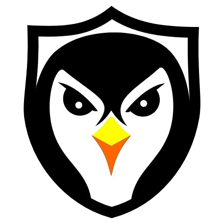

<p align="center">
  
</p>

<h1 align="center">VELINUX — Cybersecurity Learning Platform</h1>

<p align="center">
  <strong>Learn. Practice. Secure.</strong><br>
  Platform LMS cybersecurity interaktif untuk komunitas <strong>VELINUX UPN "Veteran" Jawa Timur</strong>.
</p>

---

## Tentang Proyek

VELINUX menggabungkan pembelajaran materi terstruktur (LMS), kuis dengan evaluasi otomatis dan rekomendasi AI (*Human-in-the-Loop*), gamifikasi (XP, streak, badge, leaderboard), serta lingkungan praktik **Cyber Lab** dalam satu aplikasi Laravel.

## Fitur Utama

- **Learning Management System (LMS):** Katalog kelas berdasarkan tingkat kesulitan (`Beginner`, `Intermediate`, `Advanced`, `Expert`), modul bertahap, materi teks & snippet kode, video pembelajaran pendukung, serta pelacakan progres penyelesaian materi.
- **Cyber Quiz & AI Assessment:** Dukungan soal pilihan ganda, analisis celah kode (*Find the Vulnerability*), dan esai teknis dengan evaluasi otomatis, skor, ringkasan feedback, rekomendasi materi lanjutan, serta peninjauan oleh mentor (*Human-in-the-Loop*).
- **Cyber Lab & CTF Sandbox:** Tantangan praktik terisolasi (*Linux Command Line*, *Web Security*, *Network Scanning*, *Cryptography*) dengan manajemen sesi sandbox, pratinjau terminal, dan verifikasi *flag* yang otomatis memberikan XP tanpa duplikasi poin.
- **Gamifikasi & Leaderboard:** Sistem perolehan XP (`user_points`), daily streak, peringkat komunitas, dan daftar badge pencapaian (`achievements`).
- **Admin & Mentor Panel:** Ringkasan metrik platform, validasi mentor atas hasil AI assessment, dan pencatatan `activity_logs`.
- **Tema Gelap & Terang:** Pengalih tema langsung dari navbar atas dengan penyimpanan preferensi di `localStorage` (`velinux-theme`).

## Tech Stack

- **Backend:** Laravel 13 (`laravel/framework` ^13.17), PHP 8.3+
- **Frontend:** Blade Components, Tailwind CSS v4 (`@tailwindcss/vite`), Vite 8
- **Tipografi:** Plus Jakarta Sans & JetBrains Mono
- **Database:** MySQL 8.x (lokal) / SQLite (`:memory:` untuk pengujian)
- **Testing & Quality:** Pest 5 (`pestphp/pest`), Laravel Pint

## Struktur Halaman & Rute

| Rute | Controller | Fungsi |
| :--- | :--- | :--- |
| `/` | `DashboardController` | Ringkasan progres belajar, AI assessment terbaru, daily challenge, cyber lab, course, dan leaderboard |
| `/courses` | `CourseController@index` | Katalog kelas dengan filter pencarian & tingkat kesulitan, serta playlist video pembelajaran |
| `/courses/{course:slug}` | `CourseController@show` | Pembaca modul & materi, snippet kode, navigasi *previous/next*, dan aksi tandai selesai |
| `/quizzes` | `QuizController@index` | Pengerjaan quiz & riwayat hasil evaluasi AI |
| `/labs` | `LabChallengeController@index` | Daftar lab sandbox, peluncuran sesi container, riwayat submission, dan verifikasi flag |
| `/leaderboard` | `LeaderboardController` | Peringkat XP komunitas, riwayat poin pengguna, dan daftar achievement |
| `/admin` | `AdminController@index` | Validasi mentor pada hasil AI assessment dan audit activity logs |

## Struktur Database

Skema database berada di `database/migrations/`:

- **Users & Roles:** `roles`, `users` (ditambah kolom `role_id`, `username`, `cohort`, `xp_points`, `current_streak`, `last_activity_date`, `avatar_url`, `bio`)
- **LMS & Video:** `courses`, `modules`, `lessons`, `videos`, `enrollments`, `lesson_completions`
- **Quiz & AI Evaluation:** `quizzes`, `questions`, `assessments`, `answers`, `ai_feedback`
- **Cyber Lab:** `lab_challenges`, `lab_sessions`, `submissions`
- **Gamifikasi & Audit:** `achievements`, `achievement_user`, `user_points`, `activity_logs`

## Komponen Antarmuka

Komponen Blade tersimpan di `resources/views/components/`:

- `layouts/app.blade.php` — Shell utama dengan navbar tetap, sidebar responsif, notifikasi, serta pengelola tema gelap/terang
- `velinux/navbar.blade.php` & `velinux/sidebar.blade.php` — Navigasi utama platform
- `velinux/hero-banner.blade.php` — Header workspace & aksi cepat
- `velinux/stat-card.blade.php` — Kartu metrik numerik (`tabular-nums`)
- `velinux/course-card.blade.php` — Kartu kelas & bar progres
- `velinux/ai-feedback-card.blade.php` — Kartu hasil evaluasi AI & rekomendasi pembelajaran
- `velinux/cyber-lab-card.blade.php` & `velinux/terminal-preview.blade.php` — Kartu tantangan lab, pratinjau terminal, dan form submit flag
- `velinux/quiz-challenge-card.blade.php` — Kartu ringkasan tantangan quiz
- `velinux/leaderboard-table.blade.php` — Tabel peringkat peserta

## Instalasi & Menjalankan Secara Lokal

1. **Instal dependensi PHP dan JavaScript:**
   ```bash
   composer install
   npm install
   ```

2. **Konfigurasi file `.env`:**
   ```bash
   cp .env.example .env
   php artisan key:generate
   ```
   Sesuaikan koneksi MySQL pada `.env` (pastikan database `velinux` sudah dibuat di server MySQL Anda):
   ```dotenv
   DB_CONNECTION=mysql
   DB_HOST=127.0.0.1
   DB_PORT=3306
   DB_DATABASE=velinux
   DB_USERNAME=root
   DB_PASSWORD=
   ```

3. **Jalankan migrasi dan seeder:**
   ```bash
   php artisan migrate --seed
   ```
   Seeder `Database\Seeders\VelinuxSeeder` menyediakan data contoh termasuk akun demo (password: `password`):
   - **Mahasiswa:** `raka@velinux.test`
   - **Mentor:** `mentor@velinux.test`
   - **Admin:** `admin@velinux.test`

4. **Build aset frontend atau jalankan server dev:**
   ```bash
   npm run build
   ```
   Untuk mode pengembangan interaktif:
   ```bash
   composer run dev
   ```
   *(Catatan: Jika layanan dev Laravel Herd sudah menjalankan Vite pada port `5173`, tidak perlu menjalankan `npm run dev` terpisah).*

## Pengujian & Formatting

```bash
php artisan test --compact
vendor/bin/pint --dirty --format agent
```

## Lisensi

Proyek ini menggunakan lisensi [MIT](https://opensource.org/licenses/MIT).
